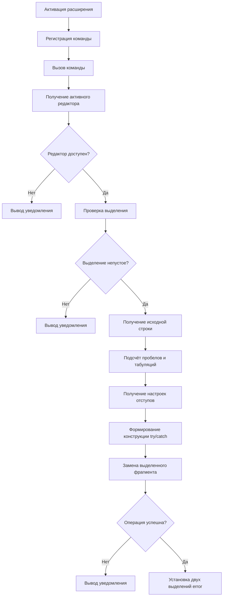

# TryCatch Helper -- лабораторная работа №3

*_исполнитель_*: Фоменко Фёдор Иванович

*_группа_*: M3105

## 1. Техническое задание

- Разработать расширение для Visual Studio Code.
- Подготовить отчет:
  - кратко описать структуру IDE в разрезе подключения к ней сторонних функциональных возможностей
  - разместить исходный код на GitHub 
  - написать README 
- Составить документацию кода

## 2. Разработка

Расширение разработано на TypeScript с использованием API Visual Studio Code.

Основная логика реализована в команде `tryCatchHelper.wrapSelection`. При её вызове расширение получает активный редактор и выделенный диапазон, формирует новую конструкцию `try/catch` и заменяет исходный фрагмент кода.

**Отступы определяются на основе настроек редактора:** используются табуляции либо заданное количество пробелов. После успешной замены создаются два выделения, позволяющие одновременно редактировать вхождения `error` в блоке `catch`.

Если редактор отсутствует, выделение пустое или операция редактирования не выполнена, расширение сообщает об этом пользователю.

## 3. Архитектура расширения

Расширение использует механизм регистрации команд VS Code. При активации регистрируется команда `tryCatchHelper.wrapSelection`, обработчик которой выполняет основную логику.

Последовательность работы:

Для взаимодействия с редактором используются объекты `TextEditor`, `TextDocument`, `Selection` и метод `editor.edit()`. Команда и её горячая клавиша объявляются в `package.json`.

## 4. Ограничения

Текущая версия ориентирована на синтаксис `try/catch`, используемый в JavaScript и TypeScript. Формирование конструкции для других языков программирования не реализовано. Корректность обработки исключений и совместимость с конкретным фрагментом кода зависят от исходного кода и контекста его использования.

## 5. Технологии

- TypeScript
- Visual Studio Code Extension API
- Node.js и npm
- Mermaid для красивенькой блоксхемы
