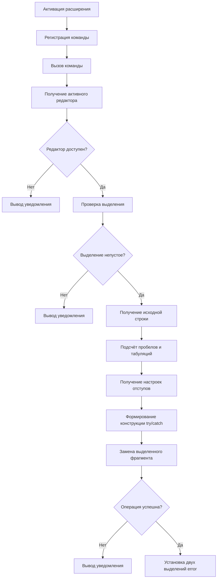

# Документация проекта TryCatch Helper

## 1. Общее описание решения

TryCatch Helper — расширение для Visual Studio Code, предназначенное для автоматической обёртки выделенного фрагмента кода в конструкцию `try/catch`.

Расширение разработано на TypeScript с использованием Visual Studio Code Extension API.

Основные возможности:
- Обёртка выделенного кода в `try/catch`.
- Сохранение исходного уровня отступа выделенного фрагмента.
- Поддержка отступов с использованием пробелов и табуляции.
- Одновременное выделение двух вхождений `error` для их редактирования.
- Вывод уведомлений при отсутствии редактора, пустом выделении или неудачном выполнении операции.

## 2. Структура проекта

Основные файлы проекта:

- `src/extension.ts` — реализация расширения, регистрация команды, обработка выделенного кода и определение отступов.
- `package.json` — описание расширения, его команд и конфигурации запуска.
- `tsconfig.json` — настройки компиляции TypeScript.
- `docs/` — документация проекта.

## 3. Архитектура расширения

При активации расширение регистрирует команду `tryCatchHelper.wrapSelection`. После вызова команды выполняется обработка активного редактора и выделенного диапазона.

Основные компоненты:

- **Extension API** — предоставляет доступ к редактору, документу, выделениям и операциям редактирования.
- **Обработчик команды** — проверяет возможность выполнения операции и управляет последовательностью действий.
- **Анализ отступов** — определяет количество пробелов и табуляций в начале первой строки выделенного фрагмента.
- **Формирование шаблона** — создаёт конструкцию `try/catch` с учётом исходного отступа и настроек редактора.
- **Обновление редактора** — заменяет исходный фрагмент и устанавливает несколько выделений.

### Схема работы

## 4. Описание функций

### 4.1. `countSpaces(str: string): number`

**Параметры:**
- `str` — строка, в которой необходимо определить количество начальных пробелов.

**Назначение:**

Функция подсчитывает количество пробелов в начале переданной строки.

Для этого выполняется последовательный обход символов строки. Пока текущий символ является пробелом, счётчик увеличивается. При встрече любого другого символа обход прекращается.

Функция возвращает полученное количество пробелов.

### 4.2. `countTabs(str: string): number`

**Параметры:**
- `str` — строка, в которой необходимо определить количество начальных символов табуляции.

**Назначение:**

Функция работает аналогично `countSpaces()`, но подсчитывает символы табуляции (`\t`) в начале строки.

Результат используется для восстановления исходного отступа выделенного фрагмента.

### 4.3. `activate(context: vscode.ExtensionContext): void`

Функция вызывается при активации расширения.

**Параметры:**
- `context` — контекст расширения, используемый для управления ресурсами, связанными с его работой.

**Назначение:**

Функция регистрирует команду `tryCatchHelper.wrapSelection` и определяет обработчик команды.

При вызове команды выполняются следующие действия:

1. Получение активного редактора через `vscode.window.activeTextEditor`.
2. Проверка наличия редактора.
3. Получение документа и текущего выделения.
4. Проверка, что выделение не пустое.
5. Определение первой и последней строк выделенного диапазона.
6. Получение текста первой строки и определение исходного отступа.
7. Подсчёт начальных пробелов и табуляций с помощью `countSpaces()` и `countTabs()`.
8. Формирование исходного отступа на основе полученных значений.
9. Определение настроек отступов редактора: использование пробелов или табуляции, а также размера отступа.
10. Формирование текста с конструкцией `try/catch`.
11. Замена исходного кода с помощью `editor.edit()`.
12. Установка двух выделений для редактирования вхождений `error`.

При определении конечной строки учитывается ситуация, когда выделение заканчивается в начале следующей строки. В таком случае последняя строка диапазона уменьшается на единицу, чтобы не захватывать лишнюю строку.

Для сохранения форматирования исходный отступ добавляется к внешней конструкции `try/catch`, а внутренний код дополнительно сдвигается на один уровень вложенности.

Если операция редактирования завершается неудачно или возникает исключение, пользователю выводится соответствующее уведомление