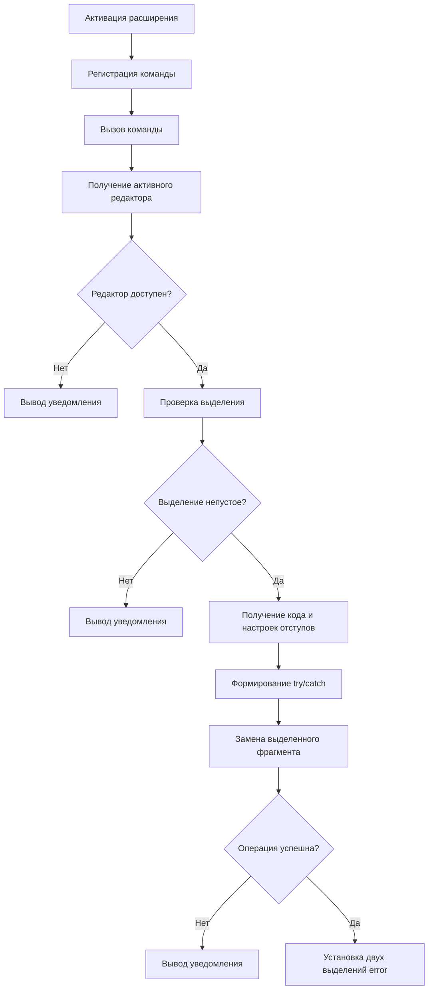

# Документация проекта TryCatch Helper

## 1. Общее описание решения

TryCatch Helper — расширение для Visual Studio Code, предназначенное для автоматической обёртки выделенного фрагмента кода в конструкцию `try/catch`.

Расширение разработано на TypeScript с использованием Visual Studio Code Extension API.

Основные возможности:
- Обёртка выделенного кода в `try/catch`.
- Одновременное выделение двух вхождений `error` для их редактирования. 
- Вывод уведомлений при отсутствии редактора, пустом выделении или неудачном выполнении операции.

## 2. Структура проекта

Основные файлы проекта:

- `src/extension.ts` — реализация расширения, регистрация команды и обработка выделенного кода.
- `package.json` — описание расширения, его команды и конфигурации запуска.
- `tsconfig.json` — настройки компиляции TypeScript.
- `docs/` — документация проекта.

## 3. Архитектура расширения

При активации расширение регистрирует команду `tryCatchHelper.wrapSelection`. После вызова команды выполняется обработка активного редактора и выделенного диапазона.

Основные компоненты:
- **Extension API** — предоставляет доступ к редактору, документу, выделениям и операциям редактирования.
- **Обработчик команды** — проверяет возможность выполнения операции и управляет последовательностью действий.
- **Формирование шаблона** — создаёт конструкцию `try/catch` с учётом отступов.
- **Обновление редактора** — заменяет исходный фрагмент и устанавливает несколько выделений.

### Схема работы



## 4. Описание функций

### 4.1. `activate(context: vscode.ExtensionContext): void`

Функция вызывается при активации расширения.

**Параметры:**
- `context` — контекст расширения, используемый для управления ресурсами, связанными с его работой.

**Назначение:**

Функция регистрирует команду `tryCatchHelper.wrapSelection` и определяет обработчик команды.

При вызове команды выполняются следующие действия:

1. Получение активного редактора через `vscode.window.activeTextEditor`.
2. Проверка наличия редактора.
3. Получение документа и текущего выделения
4. Проверка, что выделение не пустое
5. Определение начальной и конечной строк выделенного диапазона.
6. Формирование диапазона для замены с учётом целых строк
7. Получение настроек отступов редактора.
8. Формирование текста с конструкцией `try/catch`.
9. Замена исходного кода с помощью `editor.edit()`.
10. Установка двух выделений для редактирования вхождений `error`.

Если операция редактирования завершается неудачно или возникает исключение, пользователю выводится соответствующее уведомление.

**Пример использования:**

Команда вызывается через палитру команд Visual Studio Code или назначенную ей горячую клавишу.

До выполнения:

```typescript
const result = calculate();
console.log(result);
```

После выполнения:

```typescript
try {
    const result = calculate();
    console.log(result);
} catch (error) {
    console.error(error);
}
```

### 4.2. `deactivate(): void`

Функция вызывается при деактивации расширения.

**Параметры:** отсутствуют.

**Назначение:**

В текущей реализации функция не выполняет дополнительных действий. Она предусмотрена как стандартная точка завершения работы расширения.

## 5. Используемые объекты и методы API

| Объект или метод | Назначение |
|---|---|
| `vscode.window.activeTextEditor` | Получение активного редактора |
| `editor.document` | Доступ к открытому документу |
| `editor.selection` | Получение текущего выделения |
| `vscode.Range` | Получение диапазона документа |
| `document.getText()` | Получение текста заданного диапазона |
| `document.lineAt()` | Получение информации о строке |
| `editor.options` | Получение настроек пользователя |
| `editor.edit()` | Изменение содержимого документа |
| `vscode.Selection` | Создание выделения |
| `editor.selections` | Установка нескольких выделений |
| `vscode.window.showInformationMessage()` | Вывод информационных сообщений |
| `vscode.window.showErrorMessage()` | Вывод сообщений об ошибках |

## 6. Обработка ошибок и ограничения

Перед изменением документа расширение проверяет наличие активного редактора и непустого выделения.

При неудачном выполнении `editor.edit()` операция прекращается, а пользователю выводится уведомление. Исключения, возникшие при выполнении операции, перехватываются с помощью `try/catch`.

Текущая версия имеет следующие ограничения:

- Используется синтаксис `try/catch`, подходящий для JavaScript и TypeScript.
- Расширение не распознает контекст, потому ответственность за использование расширение лежит на его пользователе.

## 7. Сборка и запуск

Для разработки используется Node.js и npm.

Основные команды:

```bash
npm install
npm run compile
```

Для запуска расширения в режиме разработки необходимо открыть проект в Visual Studio Code и нажать `F5`. После этого откроется отдельное окно Extension Development Host, в котором можно проверить работу команды.